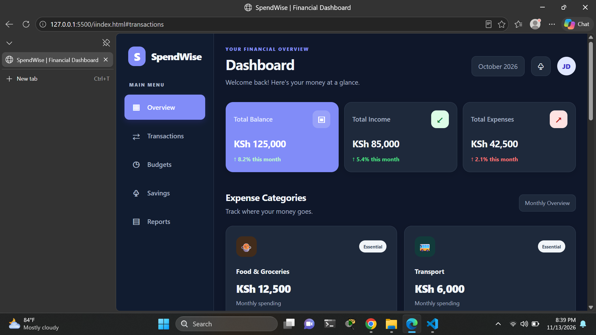
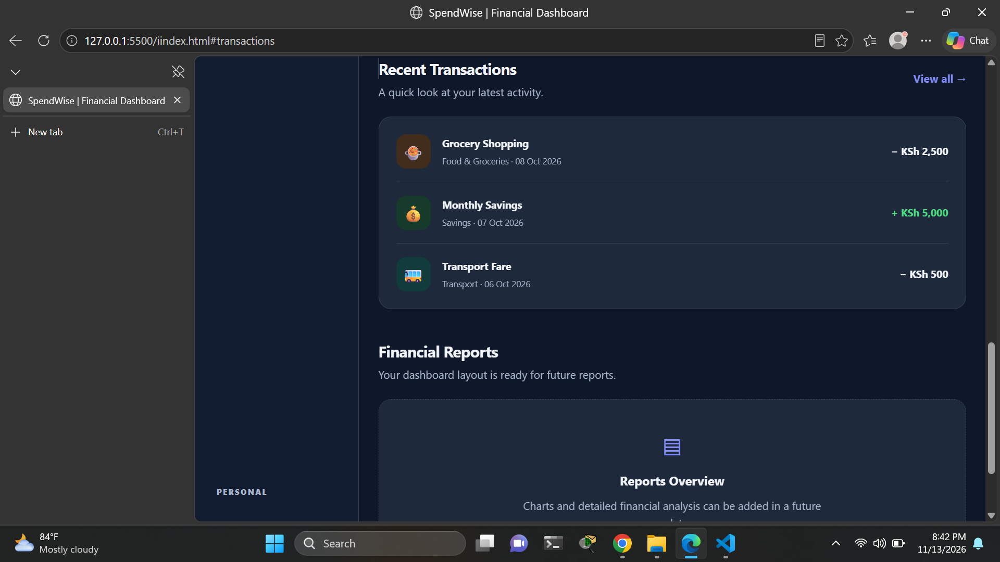
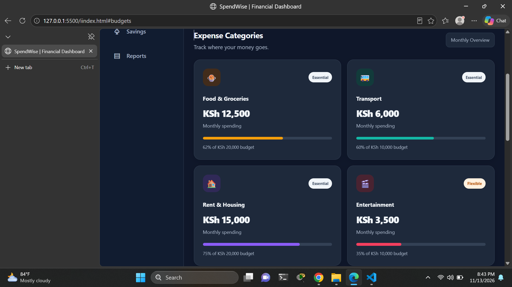

# SpendWise - Personal Finance Dashboard

A responsive, dark-themed dashboard for tracking balance, expenses, budgets and transactions.

## Live Demo
https://spendwise-dashboard-zakaria.netlify.app

## Repository
https://github.com/zakariaadanhussein765-cloud/PLP-Week-6-SpendWise

## Features
- Financial overview and balance cards
- Expense categories with budget progress bars
- Transactions section
- Savings and reports navigation
- Responsive layout

## Technologies
- HTML5
- CSS3
- Git and GitHub
- Netlify

## Screenshots

## Deployment Steps
1. Organized the project files (`index.html`, `style.css`, images) in one folder.
2. Created a public GitHub repository and pushed the project from VS Code.
3. Connected the repository to Netlify and deployed the `main` branch (no build command, publish directory set to the root).
4. Renamed the Netlify site to `spendwise-dashboard-zakaria`.
5. Tested continuous deployment by changing the page title, committing, and pushing. Netlify redeployed automatically within seconds.
6. Tested the live site for styles, links, images and responsiveness.

## Continuous Deployment
Every push to the `main` branch triggers a new Netlify deploy automatically.

## Author
Zakaria Adan Hussein
